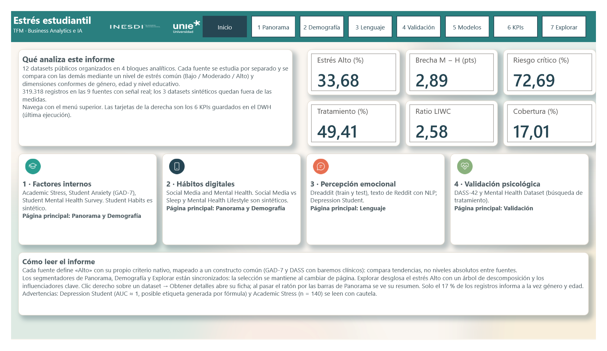
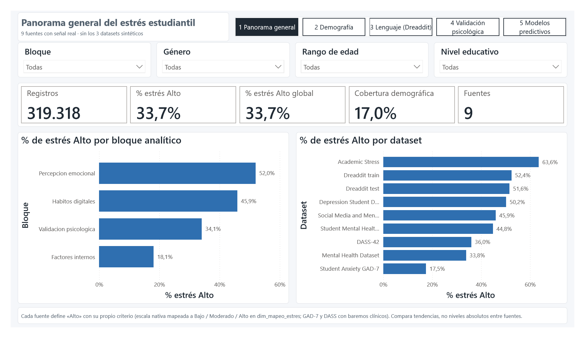
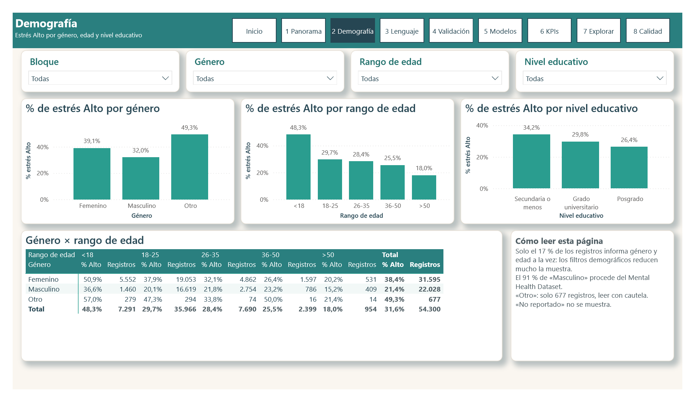
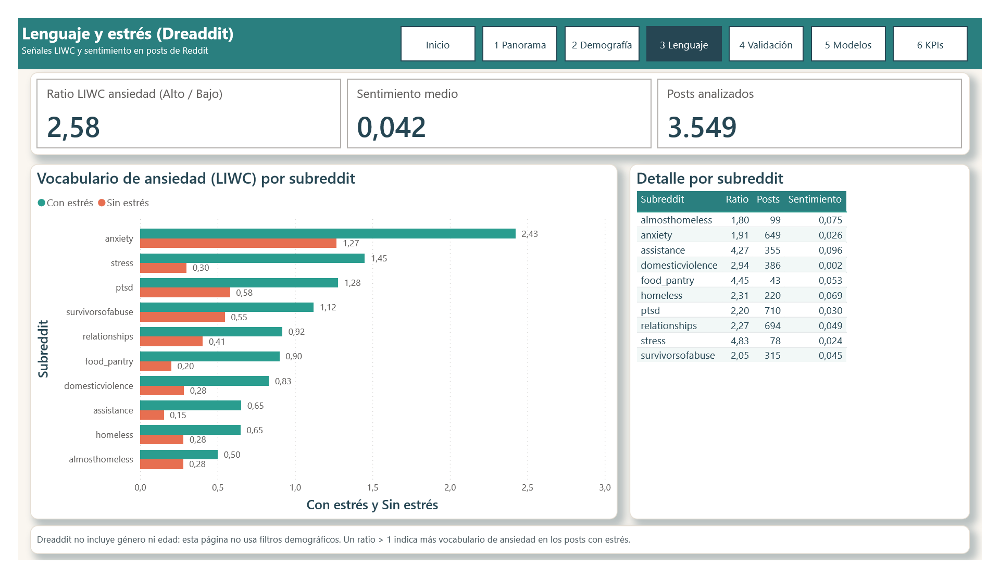
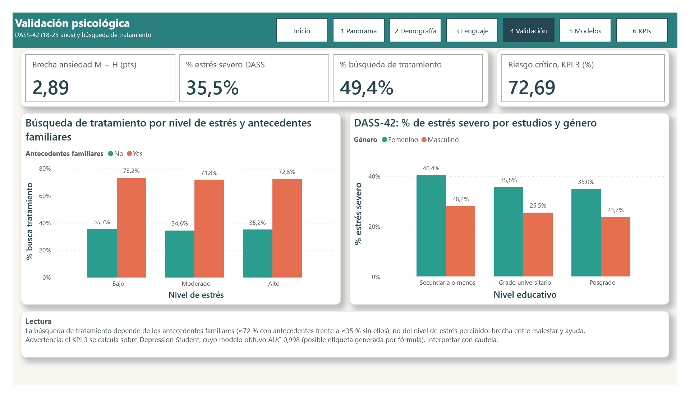
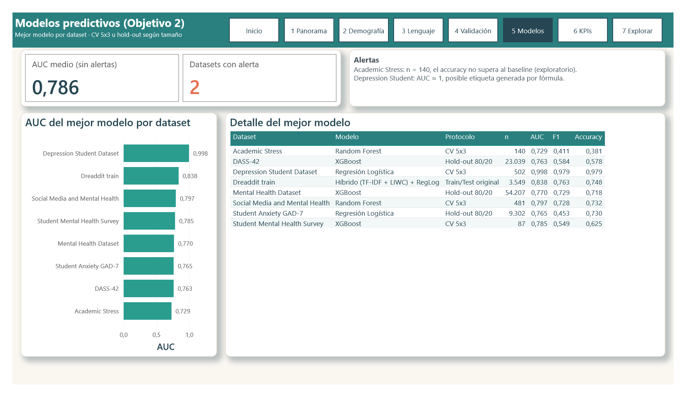
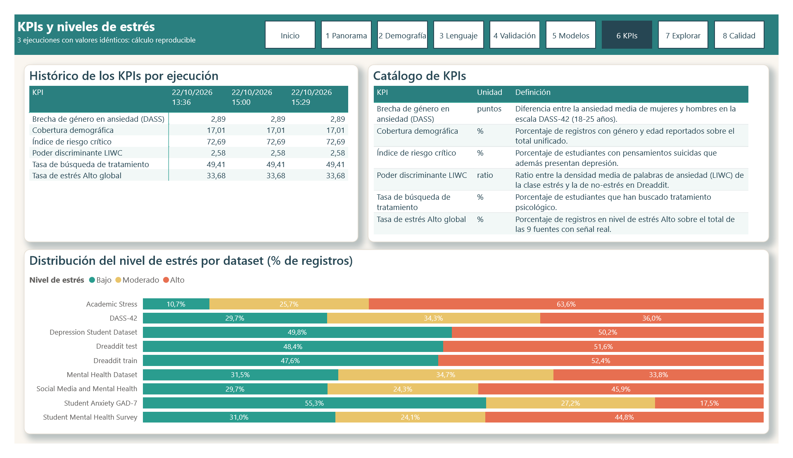
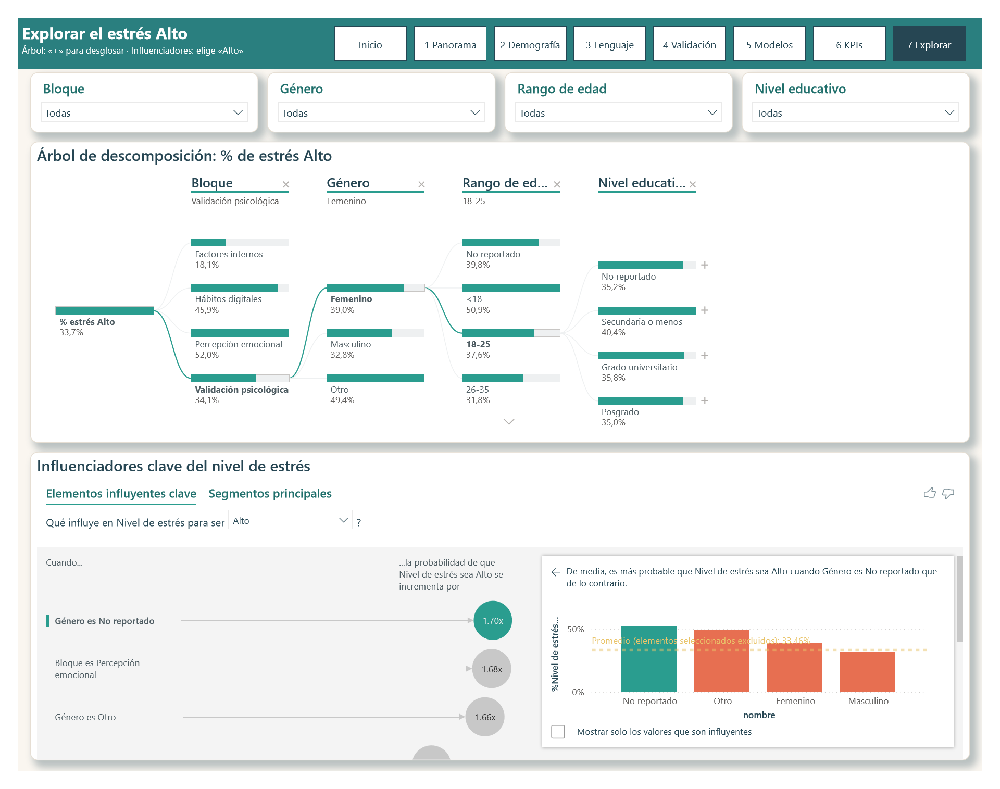

# TFM — Análisis multidimensional del estrés estudiantil

Trabajo Final de Máster en Business Analytics e Inteligencia Artificial (UNIE / INESDI). Analiza el estrés estudiantil a partir de 12 datasets públicos organizados en 4 bloques: factores internos, hábitos digitales, percepción emocional y validación psicológica. Cada fuente se estudia por separado y todas se comparan a través de un constructo común de nivel de estrés (Bajo / Moderado / Alto), sobre un modelo en estrella en MySQL, notebooks de Python y un informe de Power BI.

**Equipo:** Obed Isaí Alvarado Núñez, Roberto Mario Brochero López, Raúl Cervantes Iglesias, Andrés Francisco García Grajales, Santiago Nicolas Viuche Pinilla.

El problema, el enfoque, los objetivos y los hallazgos principales están en [`investigacion/problema.md`](investigacion/problema.md). La retroalimentación del tutor y los pendientes, en [`SEGUIMIENTO.md`](SEGUIMIENTO.md); las pruebas y validaciones, en [`tests/pruebas.md`](tests/pruebas.md); las métricas de los modelos, en [`resultados/`](resultados/README.md).

## Estructura

```
tfm-estres-estudiantil/
├── README.md
├── LICENSE                 MIT para el código; CC BY 4.0 para documentación y figuras
├── SEGUIMIENTO.md          retroalimentación del tutor por entrega, limitaciones y pendientes
├── investigacion/
│   └── problema.md         problema, enfoque, objetivos y hallazgos
├── data/
│   └── datasets/           fichas en Markdown de cada CSV original, por bloque (sin CSV)
├── sql/                    modelo MySQL v2, capa estrella para Power BI y DWH
├── notebooks/              EDA, calidad, armonización, ingesta, ETL/KPIs y modelado
├── modelos/                modelos entrenados (.pkl) con su metadata (.json)
├── resultados/             métricas del modelado
├── powerbi/                informe de Power BI (proyecto PBIP: modelo TMDL, medidas DAX, 8 páginas + 2 ocultas, tema e imágenes)
├── scripts/                exportación de MySQL a CSV, generador de las páginas y de las imágenes del informe
├── supabase/               base de datos en la nube (PostgreSQL): esquema, migración y Power BI conectado
├── prototipo/              versión web del informe en un único HTML, una carpeta por versión (v1, v2…)
├── tests/
│   └── pruebas.md          reglas de calidad, validación de la carga y del informe
├── recursos/               logos de UNIE e INESDI de origen (las versiones del informe salen de aquí)
├── figuras/                gráficos del EDA y del modelado, diagramas ERD y capturas del informe
└── docs/                   documentos de las entregas 1, 2 y 3
```

| Carpeta | Contenido |
|---|---|
| `notebooks/` | `TFM_Notebook_Entrega1_y_Entrega2.ipynb` (notebook integrado de las entregas 1 y 2), EDA 01–04, reglas de calidad 05, armonización 06, ingesta 07, validación de la carga 07b, ETL/KPIs 08 y modelado 09 |
| `sql/` | `modelo_datos_mysql.sql` (modelo v2), `esquema_estrella_powerbi.sql` (capa estrella definitiva) y `dwh_estrella.sql`. Sus diagramas están en [`figuras/diagramas/`](figuras/diagramas/README.md): `corregidos/` (versión vigente) y `entregados/` (tal como se presentaron). Los documentos entregados citan los dos primeros con sus nombres de entonces: `modelo_datos_mysql_v2.sql` y `esquema_estrella_powerbi_DEFINITIVO.sql` |
| `docs/entrega1_objetivo1/` | [Síntesis del Objetivo 1](docs/entrega1_objetivo1/01_sintesis_objetivo1_final.md), [diccionario de datos](docs/entrega1_objetivo1/03_diccionario_de_datos.md) (Excel y Markdown), [respuesta a la retroalimentación del tutor](docs/entrega1_objetivo1/02_respuesta_retroalimentacion_entrega1_v3.md) |
| `docs/entrega2_objetivo2/` | [Síntesis de ETL y KPIs](docs/entrega2_objetivo2/02_sintesis_entrega2_etl_kpis.md), [definición de KPIs](docs/entrega2_objetivo2/03_kpis_definicion.md), [síntesis del modelado](docs/entrega2_objetivo2/01_sintesis_objetivo2_modelado.md) |
| `powerbi/` | `TFM_Estres.pbip` con el modelo semántico (15 tablas, 16 relaciones, 32 medidas) (más la columna calculada `nivel_estres`) y 8 páginas en el menú: inicio (menú principal), panorama, demografía, lenguaje (Dreaddit), validación psicológica, modelos predictivos, KPIs y **Explorar** (árbol de descomposición e influenciadores clave). Dos páginas ocultas: la ficha de cada dataset (*Obtener detalles*) y el tooltip del dataset. Tema de colores «Bienestar» e imágenes en `powerbi/imagenes/` (iconos, fondo y logos) |
| `scripts/` | `exportar_mysql_cli.py` (MySQL → 15 CSV para Power BI), `generar_imagenes.py` (iconos de los bloques, fondo de Inicio y logos en blanco) y `generar_paginas_pbir.py` (reconstruye las páginas, registra las imágenes y ajusta el modelo) |
| `supabase/` | [Base de datos en Supabase](supabase/README.md): esquema PostgreSQL `tfm` (dimensiones, DWH y hechos de la capa estrella), migración validada contra MySQL, correcciones de texto y el informe de Power BI conectado con un usuario de solo lectura |
| `prototipo/` | [Prototipo web](prototipo/README.md), [publicado aquí](https://claude.ai/artifact/7DuVNnNh38qLgELbcKAG8b): las páginas del informe en un HTML sin dependencias, con los datos de Supabase. Una carpeta por versión: `v1/` (primera), `v2/` (pestaña de arquitectura), `v3/`–`v8/` (mejoras del Power BI: Explorar, ficha del dataset, tooltip, logos) y `v9/`, la final, con enlaces a los datos en vivo de Supabase |
| `docs/entrega3_objetivo3/` | [Guía del informe de Power BI](docs/entrega3_objetivo3/guia_power_bi.md) (datos, modelo, medidas, páginas y valores de control), el informe exportado a PDF y el [documento de insights](docs/entrega3_objetivo3/insights/README.md) en Word (entregable de la Entrega 3) |

## Informe de Power BI

Ocho páginas en el menú: una de inicio, que hace de menú principal, seis de análisis y **Explorar**, con los visuales de inteligencia artificial de Power BI. Los segmentadores por bloque, género, edad y nivel educativo están sincronizados entre Panorama, Demografía y Explorar. Clic derecho sobre un dataset → *Obtener detalles* abre su ficha, y al pasar el ratón por las barras de Panorama aparece su resumen. También puedes ver el [informe completo en PDF](docs/entrega3_objetivo3/informe_powerbi_TFM_Estres.pdf).

**Inicio** (menú principal): qué analiza el informe, los 6 KPIs del DWH y los 4 bloques con su icono y su página principal.



| | |
|---|---|
| **1 Panorama general**: % de estrés Alto por bloque y por dataset  | **2 Demografía**: estrés Alto por género, edad y nivel educativo  |
| **3 Lenguaje (Dreaddit)**: vocabulario de ansiedad (LIWC) por subreddit  | **4 Validación psicológica**: DASS-42 y búsqueda de tratamiento  |
| **5 Modelos predictivos**: AUC del mejor modelo por dataset  | **6 KPIs**: histórico y catálogo de los 6 KPIs y distribución Bajo / Moderado / Alto por dataset  |

**7 Explorar**: árbol de descomposición del % de estrés Alto (aquí, la ruta Validación psicológica → Femenino → 18-25 → Nivel educativo) e influenciadores clave del estrés Alto.



Los insights que salen de estas páginas, y cómo se llegó a cada uno, están en el [documento de insights](docs/entrega3_objetivo3/insights/README.md).

**Versión web interactiva:** https://claude.ai/artifact/7DuVNnNh38qLgELbcKAG8b. Reproduce el informe en el navegador, sin instalar Power BI: mismas páginas, filtros y medidas con los datos de Supabase, la página Explorar (con el botón «Ver ruta de ejemplo»), la ficha de cada dataset y una pestaña con la arquitectura de los datos.

## Fuentes de datos

Los CSV originales **no se incluyen** en el repositorio. Se descargan desde sus fuentes; la estructura, tipos, nulos y estadísticos de cada uno están en [`data/datasets/`](data/datasets/00_INDICE.md).

| Bloque | Dataset | Fuente |
|---|---|---|
| 1. Factores internos | Student Academic Stress Real World Dataset | [Kaggle](https://www.kaggle.com/datasets/poushal02/student-academic-stress-real-world-dataset) |
| 1. Factores internos | Student Mental Health Survey | [Kaggle](https://www.kaggle.com/datasets/abdullahashfaqvirk/student-mental-health-survey) |
| 1. Factores internos | Student Anxiety Dataset (GAD-7) | [Kaggle](https://www.kaggle.com/datasets/petalme/student-anxiety-dataset/data) |
| 1. Factores internos | Student Habits vs Academic Performance* | [GitHub](https://github.com/abhi88377/Student-Habits-vs-Academic-Performance/blob/main/student_habits_performance.csv) |
| 2. Hábitos digitales | Social Media Usage vs Sleep, Stress & Productivity* | [Kaggle](https://www.kaggle.com/datasets/jayjoshi37/social-media-usage-vs-sleep-stress-and-productivity) |
| 2. Hábitos digitales | Social Media and Mental Health | [Kaggle](https://www.kaggle.com/datasets/souvikahmed071/social-media-and-mental-health) |
| 2. Hábitos digitales | Mental Health Lifestyle* | [GitHub](https://github.com/datafit17/Mental_Health_Lifestyle) |
| 3. Percepción emocional | Stress Analysis in Social Media (Dreaddit, train y test) | [Kaggle](https://www.kaggle.com/datasets/payaldhokane/stress-analysis-in-social-media-dataset) |
| 3. Percepción emocional | Student Mental Health Analysis (Depression Student) | [GitHub](https://github.com/prajwalg26/Student_Mental_Health_Analysis) |
| 4. Validación psicológica | Depression Anxiety Stress Scales Responses (DASS-42) | [Kaggle](https://www.kaggle.com/datasets/lucasgreenwell/depression-anxiety-stress-scales-responses) |
| 4. Validación psicológica | Mental Health Dataset | [Kaggle](https://www.kaggle.com/code/chanchal24/mental-health-dataset/input) |

\* Datasets sintéticos: se usan en la capa descriptiva y se excluyen del modelado.

## Cómo ejecutarlo

Requisitos: Python 3 con Jupyter, y MySQL (probado con XAMPP; base de datos `tfm_estres_estudiantil_2`).

1. Descarga los CSV desde las fuentes de arriba y colócalos en `data/raw/`, un subdirectorio por bloque con la carpeta de cada dataset (p. ej. `data/raw/Bloque 1/1 Student anxiety dataset/anxiety.csv`; la ruta exacta de cada archivo está en su ficha de `data/datasets/`). Si tu MySQL tiene contraseña, ajusta `DB_PASS`.

   Los notebooks usan rutas relativas a `notebooks/`: leen los datos de `../data/raw` (`BASE`) y escriben lo que generan en `../salidas/objetivo1` o `../salidas/objetivo2` (`ALMC`). Ninguna de las dos carpetas se versiona. Ejecútalos con la carpeta `notebooks/` como directorio de trabajo (es lo habitual en Jupyter y VS Code).
2. `sql/modelo_datos_mysql.sql`
3. `sql/esquema_estrella_powerbi.sql`
4. Ingesta: `notebooks/07_carga_datos_mysql.ipynb` (o la sección B.1 del notebook integrado). Se ejecuta una sola vez; después, `07b_validacion_carga_datos.ipynb` comprueba la carga.
5. `sql/dwh_estrella.sql` (opcional; el notebook 08 crea las tablas si faltan)
6. ETL y KPIs: `notebooks/08_etl_transformaciones_kpis.ipynb` (o la sección B.2 del notebook integrado)
7. Modelado: `notebooks/09_modelado_objetivo2.ipynb`
8. Datos para Power BI: `python scripts/exportar_mysql_cli.py`. Escribe 15 CSV en `powerbi_csv/`, que no se versiona.
9. Informe: abre `powerbi/TFM_Estres.pbip` en Power BI Desktop. En *Transformar datos → Parámetros*, pon en `RutaCSV` la ruta absoluta de tu carpeta `powerbi_csv/` y pulsa *Actualizar*. Detalles en [la guía](docs/entrega3_objetivo3/guia_power_bi.md).
10. Nube (opcional): copia `supabase/.env.ejemplo` como `supabase/.env` con las credenciales de tu proyecto de Supabase y ejecuta `python supabase/scripts/migrar_mysql_a_supabase.py`; después `python supabase/scripts/preparar_powerbi_supabase.py` y abre `supabase/powerbi/TFM_Estres.pbip`. Ver [supabase/README.md](supabase/README.md).
11. Prototipo web (versión final): `python prototipo/v9/construir_prototipo.py` (lee de Supabase; `--fuente csv` para los CSV locales) y abre `prototipo/v9/prototipo_estres.html`. Para los enlaces a los datos en vivo: `python supabase/scripts/publicar_api_lectura.py` con `SUPABASE_URL` y `SUPABASE_ANON_KEY` en `supabase/.env`.

Para regenerar el informe: `python scripts/generar_imagenes.py` y `python scripts/generar_paginas_pbir.py` (con Power BI cerrado); después `python supabase/scripts/preparar_powerbi_supabase.py` para la copia de Supabase.

El notebook 06 genera la capa armonizada (CSV) que no se versiona; se regenera al ejecutarlo.

## Versiones de los notebooks

Los notebooks y scripts SQL que pasaron por varias versiones se guardan con un único nombre. Su evolución está en el historial de git: cada versión es un commit en una rama de trabajo, que después se fusionó en `main`.

| Rama | Notebook | Versiones (un commit cada una) |
|---|---|---|
| `entrega1/eda-calidad` | `01`–`04` EDA y `05_reglas_calidad_dato.ipynb` | inicial → final |
| `entrega2/etl-kpis` | `08_etl_transformaciones_kpis.ipynb` | v1 (reconstruida) → v2 → v3 → v4 |
| `notebook-integrado` | `TFM_Notebook_Entrega1_y_Entrega2.ipynb` | EDA de la Entrega 1 → Entregas 1 y 2 → versión final |
| `entrega1/modelo-datos` | `sql/modelo_datos_mysql.sql` y `figuras/diagramas/entregados/modelo_datos_ERD.png` | v1 (Entrega 1) → v2 (tras la retroalimentación del tutor) |
| `entrega1/modelo-datos` | `sql/esquema_estrella_powerbi.sql` y su diagrama | primera versión → definitiva (base `_2` y `COLLATE`) |
| `entrega3/powerbi` | `powerbi/`, `scripts/` y guía de la Entrega 3 | informe de Power BI → documentación → capturas |
| `entrega3/supabase-prototipo` | `figuras/diagramas/`, `supabase/`, `prototipo/` | diagramas corregidos → base de datos en Supabase → prototipo web con arquitectura → documentación |
| `entrega3/prototipo-versiones` | `prototipo/` | v1 recuperada (sin la pestaña de arquitectura) y v2 como versión final |
| `entrega3/pbix-entrega` | `.gitignore`, guía, `supabase/` | ficheros `.pbix` de entrega fuera del repositorio |
| `entrega3/mejoras-insights` | `powerbi/`, `scripts/`, `prototipo/`, `docs/entrega3_objetivo3/` | imágenes, Explorar, obtener detalles, tooltip y filtros sincronizados → prototipo v3–v8 → documento de insights |
| `entrega3/prototipo-v9-supabase` | `prototipo/`, `supabase/` | vistas de lectura pública en Supabase → prototipo v9 con enlaces a los datos en vivo |

Para ver una versión anterior: `git log --oneline -- notebooks/<archivo>` y `git show <commit>:notebooks/<archivo>`, o desde la pestaña *History* del archivo en GitHub.

## Estado

- **Entrega 1 (EDA, calidad, modelo de datos) y Entrega 2 (ingesta, ETL, KPIs, modelado):** completadas. Se cargaron 334.318 filas; 319.318 pertenecen a las 9 fuentes incluidas en el modelado.
- **Entrega 3 (Power BI e insights):** completada. Informe de Power BI (8 páginas, cifras validadas contra MySQL) con imágenes, obtener detalles, tooltips, filtros sincronizados, árbol de descomposición e influenciadores clave; documento de insights en Word (7 insights); base de datos migrada a Supabase y validada (17/17 tablas, 7/7 cifras de control), con el informe conectado a la nube; prototipo web (versión final v9, con enlaces a los datos en vivo de Supabase). Siguiente fase: memoria y defensa.

## Licencia

- **Código** (notebooks, scripts, SQL, proyecto de Power BI y prototipo web): [MIT](LICENSE).
- **Documentación y figuras** (documentos, informes, gráficos y documento de insights): [CC BY 4.0](https://creativecommons.org/licenses/by/4.0/deed.es). Se pueden reutilizar citando a los autores.
- **Quedan fuera:**
  - los datasets de origen, que no están en el repositorio y conservan la licencia de quien los publicó (ver [Fuentes de datos](#fuentes-de-datos));
  - los logos de UNIE e INESDI, que son marcas de sus titulares.
