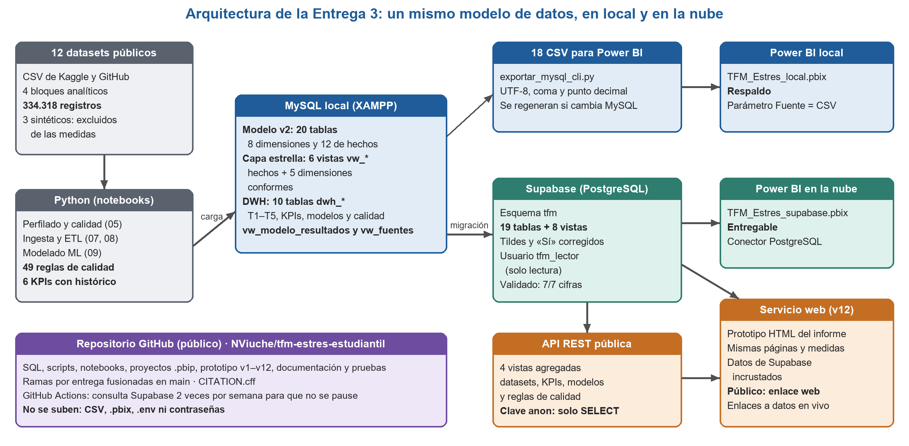
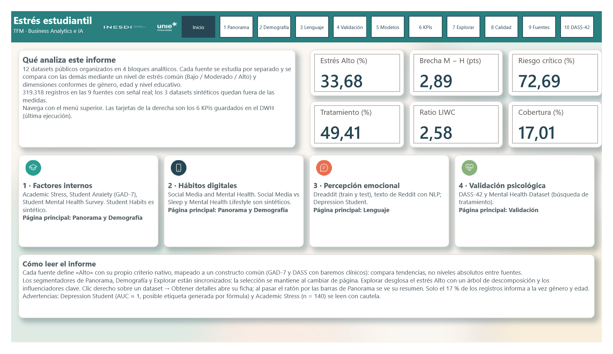
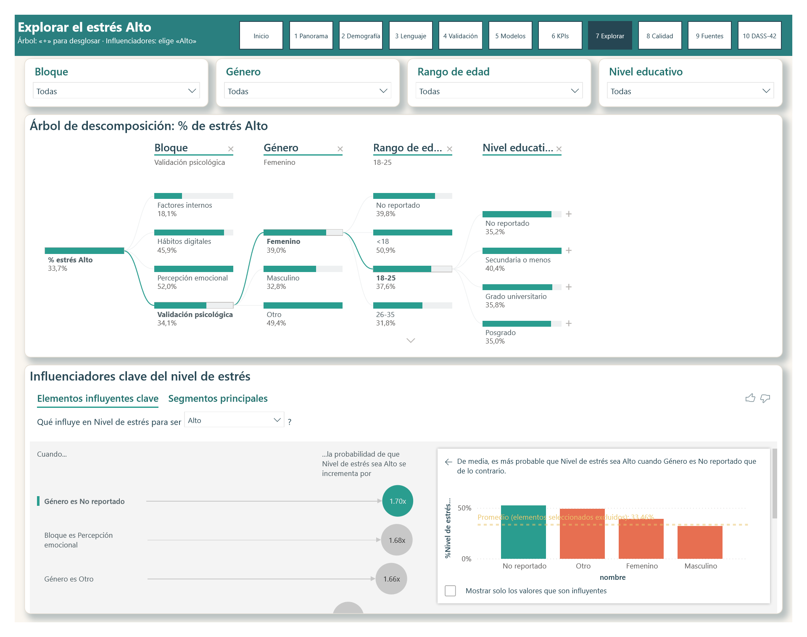

# Entrega 3: explotación de los datos con Power BI, en local, en la nube y como servicio web

*Transcripción a texto de `Sintesis_Entrega3_PowerBI.pdf`. El PDF, con las figuras, es el entregable oficial; se genera con los scripts de [`sintesis/`](sintesis/).*

**TFM — Business Analytics e Inteligencia Artificial.**

*Análisis multidimensional del estrés estudiantil mediante Business Analytics e Inteligencia Artificial*

**Grupo LUHN**

Andrés Francisco García Grajales • Obed Isaí Alvarado Núñez • Roberto Mario Brochero López

Raúl Cervantes Iglesias • Santiago Nicolas Viuche Pinilla

Esta entrega convierte el trabajo de las dos anteriores en un **informe de Power BI** para explorar el estrés estudiantil en los 12 datasets del proyecto. El mismo informe funciona de tres maneras: **en local**, leyendo el MySQL de las entregas 1 y 2; **en la nube**, conectado a una base de datos PostgreSQL en Supabase, que es el fichero entregado; y como **servicio web** público, que reproduce las páginas del informe en el navegador sin instalar Power BI. A partir del informe se documentan **9 insights** en un Word aparte, y se añade la parte opcional de la rúbrica: los modelos de machine learning del Objetivo 2, la comparación de algoritmos y los visuales de inteligencia artificial de Power BI.

Este documento explica, punto por punto, qué se hizo: la arquitectura (sección 1), los modelos SQL que alimentan el informe (2), el Power BI local (3) y en la nube (4), el diseño y las páginas del informe (5), los insights (6), la analítica avanzada (7), el servicio web (8), la calidad y el gobierno del dato (9), cómo se atienden las retroalimentaciones de las entregas anteriores (10), la verificación (11) y los entregables (12).

## 1. Arquitectura: un mismo modelo de datos, en local y en la nube

Todo el informe se apoya en el modelo de datos construido en las entregas 1 y 2. No se rehizo nada para Power BI: el informe consume la capa estrella y el datawarehouse que ya existían en MySQL, y la versión en la nube es una copia de esas mismas tablas y vistas en PostgreSQL. Por eso las cifras coinciden en los cuatro lugares donde se pueden consultar: MySQL, Supabase, los dos ficheros de Power BI y el servicio web. La tabla resume las capas y la figura 1 muestra el recorrido de los datos.

| Capa | Tecnología y objetos | Papel en la Entrega 3 |
|---|---|---|
| **Origen** | 12 datasets públicos (Kaggle y GitHub), 334.318 registros en 4 bloques | Sin cambios. Los 3 sintéticos se cargan, pero las medidas los excluyen |
| **Base local** | MySQL (XAMPP): modelo v2, capa estrella y datawarehouse | Fuente de verdad. Todo lo demás se genera desde aquí |
| **Base en la nube** | Supabase (PostgreSQL gestionado), esquema tfm: 19 tablas y 8 vistas | Fuente del Power BI entregado y del servicio web |
| **Visualización** | Power BI Desktop: proyecto .pbip (modelo TMDL y páginas PBIR) guardado como .pbix | Informe de 11 páginas en local y en la nube |
| **Servicio web** | HTML único con los datos de Supabase incrustados; API REST de solo lectura | Acceso público al informe y a los datos agregados |
| **Código y control** | Repositorio público en GitHub, ramas por entrega, GitHub Actions | Reproducibilidad, versiones y mantenimiento de Supabase |


*Figura 1. Recorrido de los datos: de los 12 CSV públicos a MySQL, y de MySQL al Power BI local (por CSV), a Supabase (Power BI en la nube y API pública) y al servicio web.*

## 2. Modelos SQL que alimentan el informe

El informe no lee las tablas originales de cada dataset, sino tres capas SQL apiladas. Las dos primeras vienen de entregas anteriores; en esta entrega se añadieron las tablas de calidad del dato, la vista de fuentes y la traducción de todo a PostgreSQL.

### 2.1 Modelo relacional (Entrega 1, modelo v2)

`modelo_datos_mysql.sql` crea las **20 tablas**: 8 dimensiones y 12 tablas de hechos (`b1_*` a `b4_*`). Tras la retroalimentación de la Entrega 1, las claves tienen nombres legibles (`id_encuesta_estres`, `id_respondente_dass`…) y cada tabla de hechos apunta con claves foráneas reales a las **dimensiones conformes** de género, rango de edad, nivel educativo y nivel de estrés, con un miembro «No reportado» (id 0) para las fuentes que no recogen un dato. La tabla `dim_mapeo_estres` documenta cómo la variable nativa de cada fuente se lleva al nivel común Bajo / Moderado / Alto.

### 2.2 Capa de consumo en estrella

`esquema_estrella_powerbi.sql` crea **6 vistas** pensadas para Power BI: `vw_hechos_estres` (una fila por registro de cualquiera de los 12 datasets, 334.318 filas, con sus cinco claves conformes) y las dimensiones `vw_dim_dataset`, `vw_dim_genero`, `vw_dim_rango_edad`, `vw_dim_nivel_educativo` y `vw_dim_nivel_estres`. Es lo que permite que un solo filtro, como «Mujeres de 18 a 25 años», actúe a la vez sobre todas las fuentes.

### 2.3 Datawarehouse (Entrega 2) y lo añadido en esta entrega

| Objeto | Origen | Uso en el informe |
|---|---|---|
| `dwh_hechos_estres_unificado` | dwh_estrella.sql (T1) | Registros de las 9 fuentes con señal real (319.318) |
| `dwh_agg_prevalencia (T2)` | Notebook 08 | Prevalencia por bloque, género y edad (página Demografía) |
| `dwh_nlp_senales (T3)` | Notebook 08 | Señales LIWC y sentimiento por subreddit (página Lenguaje) |
| `dwh_dass_severidad (T4)` | Notebook 08 | DASS-42 por género y estudios (páginas Validación y DASS-42) |
| `dwh_brecha_tratamiento (T5)` | Notebook 08 | Tratamiento según estrés y antecedentes (página Validación) |
| `dwh_kpi_catalogo / _resultados` | Notebook 08 | Definición e histórico de los 6 KPIs (Inicio y página KPIs) |
| `dwh_modelo_resultados` | Notebook 09 | Métricas de los modelos del Objetivo 2 (página Modelos) |
| `vw_modelo_resultados` | Vista | Última ejecución de cada modelo; comparte vw_dim_dataset con los hechos (constelación) |
| **Nuevo:** `dwh_calidad_reglas` | cargar_calidad_dato.py | Las 49 reglas de calidad del notebook 05, con su dimensión, resultado y tratamiento |
| **Nuevo:** `dwh_calidad_controles` | cargar_calidad_dato.py | Registro de 17 controles de carga, ETL, migración, seguridad e informe |
| **Nuevo:** `vw_fuentes` | vw_fuentes_mysql.sql | Une dim_dataset y dim_mapeo_estres: fuente, columnas originales y criterio de cada dataset (página Fuentes) |

### 2.4 Traducción a PostgreSQL (Supabase)

La versión en la nube no es una exportación manual: seis scripts SQL recrean en PostgreSQL, dentro del esquema tfm, exactamente los objetos que usa el informe, con los mismos nombres y columnas, de modo que el modelo de Power BI no cambia al pasar de un motor a otro.

| Script | Qué crea |
|---|---|
| `01_esquema.sql` | Las 8 dimensiones, las 8 tablas dwh_* y la tabla hechos_estres, que guarda como tabla la vista vw_hechos_estres (las tablas b1_* … b4_* se quedan en MySQL) |
| `02_vistas.sql` | Las 7 vistas vw_* con los mismos nombres y columnas que en MySQL |
| `03_correcciones_datos.sql` | Tildes en bloques, KPIs, modelos y descripciones, y «Yes» → «Sí» en los antecedentes familiares (solo en Supabase; MySQL queda igual) |
| `04_api_lectura_publica.sql` | 4 vistas agregadas en el esquema public para la API REST, con permiso solo de lectura |
| `05_calidad_dato.sql` | Las 2 tablas de calidad del dato |
| `06_vista_fuentes.sql` | La vista vw_fuentes |

## 3. Power BI en local

El informe se construyó como **proyecto de Power BI (.pbip)**: el modelo semántico se guarda en TMDL y las páginas en PBIR, ambos formatos de texto. Así el informe se puede versionar en git y regenerar con scripts: `generar_imagenes.py` dibuja los iconos de los bloques, el fondo de Inicio y los logos de INESDI y UNIE, y `generar_paginas_pbir.py` escribe los objetos visuales de las 13 páginas, el orden del menú y los ajustes del modelo. Para la entrega, el proyecto se guarda como .pbix.

### 3.1 Conexión: de MySQL a CSV

El modelo tiene un parámetro `Fuente` con tres orígenes posibles (MySQL, CSV y Supabase). La conexión directa a MySQL no funciona con el MySQL de XAMPP: al conectar sin cifrado, Power BI pide el modo SSL «None», que su conector ya no admite. Por eso la versión local lee **18 CSV** que `exportar_mysql_cli.py` exporta del MySQL (UTF-8, coma como separador y punto decimal); el parámetro `RutaCSV` indica su carpeta. Los CSV se regeneran cada vez que cambian los datos en MySQL, y prevalece siempre MySQL: sin filtros, el informe debe mostrar 319.318 registros y un 33,7 % de estrés Alto.

### 3.2 Modelo semántico

**18 tablas de datos** (los hechos, las 5 dimensiones conformes, 2 dimensiones auxiliares, los 4 hechos agregados T2–T5, los KPIs, los modelos, la calidad del dato y las fuentes), **18 relaciones** uno a varios con el filtro desde la dimensión hacia los hechos, **53 medidas DAX** y 2 columnas calculadas. Decisiones principales:
- **Sintéticos fuera sin filtrar a mano.** Todas las medidas de volumen filtran `uso_modelado = "incluido"`: los 3 datasets sintéticos se cargan, pero no cuentan en ninguna cifra de análisis.
- **Constelación.** `vw_dim_dataset` filtra a la vez los registros, los resultados de los modelos, las reglas de calidad y las fuentes; género, edad y nivel educativo filtran los hechos y las tablas agregadas.
- **Orden y formato.** Edad, nivel de estrés y nivel educativo se ordenan por su id; las claves id_* están ocultas; las métricas de los modelos no se suman.
- **Columnas calculadas.** `nivel_estres` (con RELATED) permite que los influenciadores clave analicen fila a fila, y `familia` agrupa cada modelo con su algoritmo base para comparar los mismos algoritmos en las 8 fuentes.

Ejemplos de medidas DAX:

```dax
Registros = CALCULATE ( COUNTROWS ( vw_hechos_estres ),
                        vw_dim_dataset[uso_modelado] = "incluido" )
% Estrés Alto = DIVIDE ( [Registros estrés Alto], [Registros] )
Cobertura demográfica = DIVIDE ( CALCULATE ( [Registros], vw_dim_genero[id_genero] <> 0,
                                 vw_dim_rango_edad[id_rango_edad] <> 0 ), [Registros] )
Brecha de género en ansiedad = [Ansiedad media DASS (mujeres)]
                             - [Ansiedad media DASS (hombres)]
```

Las medidas de calidad (% de reglas superadas, % de edad informada…) cuentan los 12 datasets, porque miden la carga y no el análisis.

### 3.3 Correcciones al proyecto inicial

La primera versión del proyecto no abría en Power BI Desktop. Se corrigieron los grupos de consultas sin declarar, las medidas AUC, F1 y Accuracy que chocaban con columnas del mismo nombre (pasaron a AUC medio, F1 medio y Accuracy media), el nombre del conector (MySQL.Database) y la medida «Modelos con alerta», que contaba los 4 modelos de cada dataset en lugar de solo el mejor.

## 4. Power BI en la nube (Supabase)

Para que el informe no dependa de un MySQL en el equipo de cada persona, la base de datos se migró a **Supabase**, un servicio gestionado de PostgreSQL. El fichero **TFM_Estres_supabase.pbix** es el entregable de esta entrega: al pulsar Actualizar, lee los datos de la nube.
- **Migración automatizada.** `migrar_mysql_a_supabase.py` ejecuta los scripts SQL de la sección 2.4, copia los datos desde MySQL y crea el usuario de solo lectura. Rehace el esquema desde cero, así que puede repetirse siempre que cambien los datos.
- **Validación contra MySQL.** El mismo script compara las filas de cada tabla y 7 cifras de control: 319.318 registros, 33,68 % de estrés Alto, 17,0 % de cobertura, 49,41 % de tratamiento, 3.549 posts, AUC medio 0,786 y 2 datasets con alerta. Resultado: 7 de 7. El 17/11/2026, las 19 tablas y la vista vw_fuentes tenían las mismas filas en las dos bases (20 de 20).
- **Mismo informe, otro conector.** `preparar_powerbi_supabase.py` genera la versión de la nube a partir del informe local: cambia el parámetro a `Fuente = "Supabase"`, usa el conector PostgreSQL y adapta la medida de antecedentes a «Sí». Las páginas, medidas y relaciones son idénticas.
- **Textos corregidos.** MySQL guarda los nombres sin tildes («Percepcion emocional», «Tasa de estres…») y los antecedentes como «Yes / No». En Supabase se corrigen con 03_correcciones_datos.sql, por eso el entregable es la versión de la nube.
- **Acceso seguro.** Power BI se conecta con el usuario `tfm_lector`, que solo puede leer el esquema tfm; cualquier escritura da error. Las credenciales viven en un fichero .env que nunca se sube al repositorio.
- **Supabase siempre activo.** El plan gratuito pausa los proyectos sin actividad. Una tarea de GitHub Actions consulta la base dos veces por semana (lunes y jueves) para evitarlo; se probó a mano el 17/11/2026 con respuesta correcta.

## 5. El informe: diseño y páginas

El informe tiene **11 páginas en el menú y 2 ocultas**. La rúbrica evalúa tres aspectos; la tabla resume cómo se cubre cada uno y la figura 2 muestra el menú principal.

| Criterio de la rúbrica | Cómo se cubre |
|---|---|
| **Diseño atractivo** | Página de Inicio como menú principal, con fondo propio, los logos de INESDI y UNIE y un recuadro con icono por cada bloque. Tema de colores propio «Bienestar» (teal, arena y coral sobre crema), tarjetas con borde redondeado y sombra, y en todas las páginas una banda con título, subtítulo y un menú de 11 botones |
| **Capacidad de explotación** | Segmentadores de bloque, género, rango de edad y nivel educativo sincronizados entre páginas; jerarquía bloque → dataset en los gráficos; tooltip de página al pasar el ratón; ficha de cada dataset con clic derecho → Obtener detalles y botón Volver; filtros cruzados entre todos los visuales |
| **Generación de insights** | Página Explorar con dos visuales de inteligencia artificial: árbol de descomposición del % de estrés Alto (con «Valor alto / bajo», que busca solo el corte con más estrés) e influenciadores clave del nivel de estrés. Notas de lectura y advertencias en cada página |


*Figura 2. Página de Inicio (menú principal): los 6 KPIs del datawarehouse, los 4 bloques analíticos y el menú de navegación.*

| Página | Contenido |
|---|---|
| **Inicio** | Qué analiza el informe, los 6 KPIs del DWH (última ejecución), un recuadro por bloque con su página y nota de lectura |
| **1 Panorama** | Registros, % de estrés Alto, cobertura y fuentes; % de estrés Alto por bloque (con jerarquía hasta dataset) y por dataset |
| **2 Demografía** | % de estrés Alto por género, edad y estudios, y matriz género × edad |
| **3 Lenguaje** | Dreaddit: vocabulario de ansiedad (LIWC) con y sin estrés por subreddit, ratio y sentimiento |
| **4 Validación** | Brecha de ansiedad, estrés severo DASS, búsqueda de tratamiento por estrés y antecedentes |
| **5 Modelos** | AUC del mejor modelo por dataset, alertas, protocolo y métricas, y comparación de los tres algoritmos (AUC y sobreajuste) |
| **6 KPIs** | Histórico de los 6 KPIs por ejecución, catálogo con su definición y distribución Bajo / Moderado / Alto por dataset |
| **7 Explorar** | Árbol de descomposición e influenciadores clave (figura 3) |
| **8 Calidad** | Reglas por dimensión de calidad y estado, completitud por dataset, reglas con aviso y registro de controles |
| **9 Fuentes** | Catálogo de los 12 datasets (fuente, filas, columnas, calidad, uso) y criterio con que cada uno define Bajo / Moderado / Alto |
| **10 DASS-42** | Depresión, ansiedad y estrés por género y estudios (18-25 años) y estrés Alto por edad |
| **Ocultas** | Detalle del dataset (destino de Obtener detalles) y Tooltip del dataset (320 × 240) |


*Figura 3. Página 7 (Explorar): árbol de descomposición con la ruta Validación psicológica → Femenino → 18-25 → Nivel educativo, e influenciadores clave del estrés Alto.*

## 6. Insights

Los insights se documentan en **Insights_PowerBI_TFM_Estres.docx**, con capturas de las 11 páginas. Todos se obtuvieron con el mismo procedimiento, que también sirve para reproducirlos:
- **Detectar** un patrón en un gráfico o una tarjeta.
- **Aislar** con los segmentadores y el árbol de descomposición si el patrón se mantiene en cada subgrupo.
- **Descartar el efecto composición:** como las fuentes tienen tamaños muy distintos, cada insight se comprobó también dentro de cada dataset.
- **Contrastar** con las tablas del DWH, los KPIs, los modelos y los influenciadores clave, y con las mismas cifras calculadas en SQL sobre MySQL y Supabase.

| N.º | Insight | Dato clave | Página |
|---|---|---|---|
| 1 | Buscar ayuda depende de los antecedentes familiares, no del nivel de estrés | ≈ 72 % frente a ≈ 35 %, igual en los tres niveles | 4 |
| 2 | Las mujeres reportan más estrés que los hombres en casi todas las fuentes | 39,1 % frente a 32,0 %; 5 de 6 fuentes | 2, 4 y 10 |
| 3 | El estrés Alto disminuye con la edad | 48,3 % (<18) → 18,0 % (>50) | 2 y 10 |
| 4 | A más nivel educativo, menos estrés Alto y severo | 34,2 % → 29,8 % → 26,4 % | 2 y 4 |
| 5 | El lenguaje delata el estrés, sobre todo fuera de los foros de ansiedad | Ratio LIWC 2,58; 4,83 en r/stress | 3 |
| 6 | El porcentaje global lo marca una sola fuente: se comparan tendencias, no niveles | Una fuente = 81,8 % de los registros | 1, 6 y 9 |
| 7 | La señal predictiva es real pero moderada, y dos fuentes exigen cautela | AUC medio 0,786; 2 con alerta | 5 |
| 8 | Los datos son de buena calidad, pero la completitud demográfica limita los cruces | 39 de 49 reglas, 0 errores; edad en el 20,7 % | 8 |
| 9 | Un modelo simple basta: la Regresión Logística iguala a los complejos sin sobreajustar | A menos de 0,015 de AUC del mejor | 5 |

> **Cómo leer las cifras.** Cada fuente define «Alto» con su propio criterio (por ejemplo, GAD-7 ≥ 10 o un índice 4–5 sobre 5), que la página 9 muestra dataset a dataset. Por eso el informe compara tendencias dentro de cada fuente y no niveles absolutos entre fuentes (insight 6).

## 7. Analítica avanzada (parte opcional)
- **Machine learning (Objetivo 2).** Los modelos del notebook 09 (Regresión Logística, Random Forest y XGBoost en 8 tareas, y TF-IDF con LIWC en Dreaddit) guardan sus métricas en el datawarehouse, y la página 5 las muestra por dataset con sus alertas: Depression Student (AUC 0,998, no creíble en datos de encuesta) y Academic Stress (140 registros).
- **Comparación de algoritmos.** La página 5 compara los tres algoritmos en las 8 fuentes por AUC y por sobreajuste (accuracy de entrenamiento menos accuracy de prueba). La Regresión Logística queda a menos de 0,015 de AUC del mejor modelo en todas y es la que menos sobreajusta en 7 de 8 (insight 9).
- **Inteligencia artificial de Power BI.** Los influenciadores clave estiman qué valores multiplican la probabilidad de estrés Alto (por ejemplo, «Rango de edad es <18», 1,51 veces) y el árbol de descomposición encuentra solo los cortes con más estrés.
- **Perfil DASS-42.** Entre los 18 y los 25 años (23.039 respondentes), las medias son 35,0 en depresión, 30,4 en ansiedad y 35,2 en estrés, con un 35,5 % de estrés severo; la diferencia de género está en la ansiedad y el estrés, no en la depresión.

## 8. Servicio web

El informe también se publicó como **servicio web público**, abierto a cualquier persona con el enlace:

[https://claude.ai/artifact/7DuVNnNh38qLgELbcKAG8b](https://claude.ai/artifact/7DuVNnNh38qLgELbcKAG8b)

Es un único fichero HTML que reproduce las páginas del Power BI con los mismos datos, filtros y medidas, así que cualquier persona puede explorar el informe desde el navegador, sin instalar Power BI ni tener credenciales.
- **Cómo se construye.** `construir_prototipo.py` lee los datos de Supabase con el usuario de solo lectura y los incrusta en el HTML; con `--fuente csv` usa los CSV del Power BI local. Las cifras coinciden con el informe: 319.318 registros y 33,7 % de estrés Alto.
- **Qué incluye.** Las 11 páginas, la ficha de cada dataset con un clic (equivale a Obtener detalles), el tooltip de los bloques, el árbol de descomposición con los botones «Ver ruta de ejemplo» y «Reiniciar», y una pestaña **Arquitectura** con los diagramas del modelo de datos, donde cada paso del recorrido abre su notebook o script en el repositorio.
- **Datos en vivo.** Desde la pestaña Arquitectura se consultan 4 vistas de la API REST de Supabase en JSON: catálogo de datasets (12 filas), KPIs (6), mejor modelo por dataset (8) y reglas de calidad (49). La clave pública solo permite leer esas vistas agregadas, sin registros individuales; cualquier escritura devuelve un error de permisos.
- **Versionado.** Cada versión vive en su carpeta (v1 a v12) y las anteriores no se modifican. La v12, la final, añade las páginas Fuentes y DASS-42 y la comparación de algoritmos. Cada cambio del Power BI se ha llevado al servicio web en el mismo enlace.

## 9. Calidad y gobierno del dato

La página 8 hace visible en el informe el trabajo de calidad de todo el proyecto, organizado según las áreas del marco DAMA-DMBOK:

| Área | Evidencia |
|---|---|
| **Calidad del dato** | 49 reglas antes de la carga: 39 superadas (79,6 %), 10 avisos con su tratamiento y 0 errores. 17 controles de carga, ETL, migración, seguridad e informe: 14 superados y 3 avisos conocidos |
| **Metadatos y linaje** | Página Fuentes (vw_fuentes): origen, filas, columnas originales (576 en total) y criterio de cada dataset; catálogo de KPIs con definición y unidad |
| **Datos de referencia** | 4 dimensiones conformes con el miembro «No reportado»; completitud medida: género 95,6 %, edad 20,7 %, nivel educativo 15,3 % |
| **Seguridad y acceso** | Usuario tfm_lector de solo lectura, API pública solo con vistas agregadas, credenciales fuera del repositorio |
| **Aptitud de uso** | Sintéticos excluidos de las medidas; alertas de modelos y advertencias (KPI 3 de riesgo crítico) visibles en el informe |

## 10. Respuesta a las retroalimentaciones recibidas

Las observaciones del tutor en las entregas anteriores se reflejan así en el informe:

| Observación | Cómo se refleja en la Entrega 3 |
|---|---|
| *«En Power BI será imposible aplicar un filtro global de Mujeres de 18 a 25 años»* (Entrega 1) | Resuelto con las dimensiones conformes: los segmentadores de género, edad y estudios filtran a la vez todas las fuentes y se mantienen al cambiar de página. La ruta de ejemplo del árbol de descomposición (Validación psicológica → Femenino → 18-25) aplica exactamente ese filtro |
| *«El TFM corre el riesgo de fragmentarse en 4 o 5 mini-proyectos»* | Un único modelo semántico en constelación: registros, KPIs, modelos, calidad y fuentes comparten las mismas dimensiones, y el informe se recorre como un análisis unificado |
| *«Falta un planteamiento claro de qué se va a medir en la capa global»* | El nivel de estrés Bajo / Moderado / Alto es el eje de todas las páginas, y la página 9 (Fuentes) muestra con qué criterio se lleva a él la variable de cada dataset |
| *«Los datos sintéticos restan validez científica»* | Los 3 sintéticos se cargan, pero todas las medidas de análisis los excluyen y no se modelan; la página Fuentes los identifica |
| *Claves «registro_id» poco legibles* | Las claves semánticas del modelo v2 llegan intactas a MySQL, Supabase y Power BI |
| *Trazabilidad de los KPIs históricos* (Entrega 2, valorada) | La página 6 muestra el histórico de ejecuciones de los 6 KPIs (las 3 ejecuciones dan los mismos valores: cálculo reproducible) y su catálogo |

## 11. Verificación

Antes de cerrar la entrega se comprobó que el informe y sus copias dan las mismas cifras y que el código funciona. Valores de control sin filtros:

| Medida | Valor (MySQL = Supabase = Power BI = web) |
|---|---|
| Registros analizados | 319.318 |
| % de estrés Alto | 33,7 % |
| Cobertura demográfica | 17,0 % |
| Brecha de ansiedad mujeres − hombres (DASS) | 2,89 puntos |
| Ratio discriminante LIWC | 2,58 |
| Búsqueda de tratamiento | 49,4 % |
| AUC medio sin alertas · datasets con alerta | 0,786 · 2 |
| Reglas de calidad · controles | 39 de 49 · 14 de 17 |

- **Modelo de Power BI:** los dos informes cargan sin errores; todos los campos que usan los visuales existen en el modelo, ningún visual se sale de su página y las columnas coinciden con los CSV en las 18 tablas.
- **Supabase:** 20 de 20 tablas y vistas con las mismas filas que MySQL; el usuario lector no puede escribir; las 4 vistas de la API responden.
- **Código y repositorio:** los scripts de Python compilan, los JSON del informe son válidos, el servicio web no contiene claves privadas y los 144 enlaces de la documentación funcionan. El detalle está en tests/pruebas.md.

## 12. Entregables

| Archivo | Contenido |
|---|---|
| **TFM_Estres_supabase.pbix** | Fichero Power BI entregado, conectado a Supabase (Actualizar pide el usuario tfm_lector) |
| **TFM_Estres_local.pbix** | Respaldo con los mismos datos, leídos de los CSV del MySQL local |
| **Insights_PowerBI_TFM_Estres.docx** | Documento Word con los 9 insights, cómo se encontraron y las capturas del informe |
| **informe_powerbi_TFM_Estres.pdf** | Exportación a PDF de las páginas del informe |
| **Servicio web** | [https://claude.ai/artifact/7DuVNnNh38qLgELbcKAG8b](https://claude.ai/artifact/7DuVNnNh38qLgELbcKAG8b) |
| **Repositorio** | [https://github.com/NViuche/tfm-estres-estudiantil](https://github.com/NViuche/tfm-estres-estudiantil) |
| **Sintesis_Entrega3_PowerBI.pdf** | Este documento |

> **Acceso al Power BI de la nube.** TFM_Estres_supabase.pbix se abre con los datos incluidos, sin credenciales: todas las páginas, filtros y cifras se pueden revisar sin conexión. Solo para pulsar Actualizar y leer los datos en vivo de Supabase hacen falta las credenciales del usuario de solo lectura `tfm_lector`, que se facilitan al tutor por un canal privado y no se incluyen en este documento.

En el repositorio están el SQL de MySQL y de Supabase, los scripts, los proyectos .pbip, el servicio web (v1 a v12), la guía del informe (`docs/entrega3_objetivo3/guia_power_bi.md`) y las pruebas. Por seguridad no se suben los CSV, los .pbix (llevan los datos dentro) ni las credenciales.

### Limitaciones
- Las comparaciones demográficas se apoyan en pocas fuentes: solo el 17 % de los registros informa a la vez género y edad.
- Los datos son autorreportados y cada fuente define el estrés con su propio criterio; se comparan tendencias, no niveles.
- La versión local depende de exportar CSV, porque el conector de Power BI no admite el MySQL de XAMPP sin cifrado.

**Relacionado:** [README](../../README.md) · [Guía de Power BI](guia_power_bi.md) · [Documento de insights](insights/README.md) · [Síntesis ETL y KPIs](../entrega2_objetivo2/02_sintesis_entrega2_etl_kpis.md) · [Pruebas](../../tests/pruebas.md)
