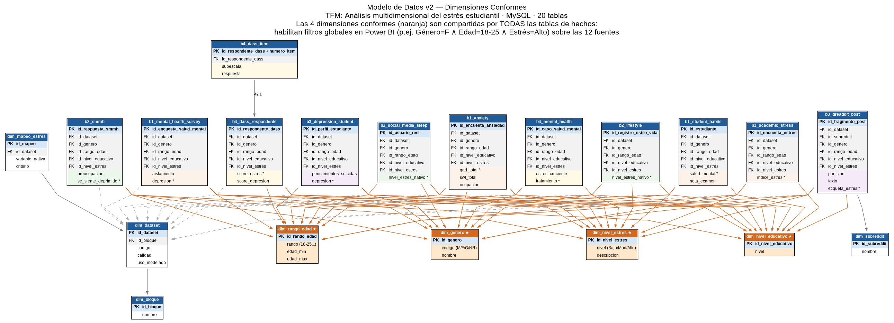
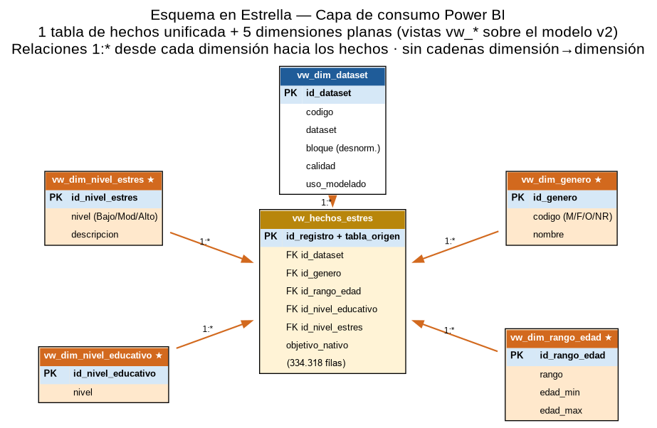
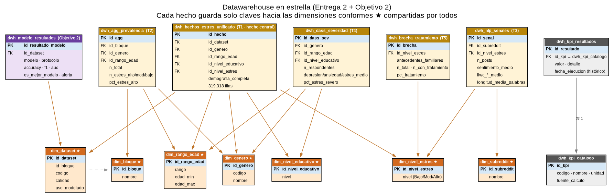

# Diagramas del modelo de datos

Los tres diagramas describen el mismo modelo en tres capas, en el orden en que recorren los datos: el modelo de datos en MySQL, la capa de consumo que lee Power BI y el DWH con los KPIs. Las imágenes de esta página son la versión vigente (`corregidos/`).

| Diagrama | Qué muestra | Script SQL |
|---|---|---|
| [Modelo de datos](#1-modelo-de-datos-v2-mysql) | Modelo v2 en MySQL: 8 dimensiones (4 conformes ★) y 12 tablas de hechos, una o dos por dataset | [`sql/modelo_datos_mysql.sql`](../../sql/modelo_datos_mysql.sql) |
| [Capa de consumo](#2-capa-de-consumo-para-power-bi) | Vistas `vw_*` en estrella para Power BI: 1 hecho y 5 dimensiones | [`sql/esquema_estrella_powerbi.sql`](../../sql/esquema_estrella_powerbi.sql) |
| [DWH](#3-dwh-del-notebook-08) | Hechos derivados por KPI, catálogo y resultados de los KPIs y del modelado | [`sql/dwh_estrella.sql`](../../sql/dwh_estrella.sql) |

## 1. Modelo de datos (v2, MySQL)

20 tablas: 8 dimensiones, 4 de ellas conformes (★: género, rango de edad, nivel educativo y nivel de estrés), y 12 tablas de hechos, una o dos por dataset. Es la base sobre la que se cargan los 12 CSV ([`notebooks/07_carga_datos_mysql.ipynb`](../../notebooks/07_carga_datos_mysql.ipynb)).

## 2. Capa de consumo para Power BI

Siete vistas `vw_*` sobre el modelo v2, sin copiar datos. `vw_hechos_estres` une las tablas de hechos con UNION ALL y devuelve 334.318 filas de los 12 datasets; las medidas del informe filtran después los 9 con señal real. Es una estrella pura: un hecho y 5 dimensiones planas 1:*. En Supabase, `vw_hechos_estres` se guarda como la tabla `hechos_estres`.

## 3. DWH del notebook 08

Las 8 tablas `dwh_*` que calcula el ETL ([`notebooks/08_etl_transformaciones_kpis.ipynb`](../../notebooks/08_etl_transformaciones_kpis.ipynb)): hechos unificados (319.318 filas de los 9 datasets con señal real), agregados por KPI, catálogo y resultados de los 6 KPIs, y resultados del modelado. Alimentan las páginas Lenguaje, Validación, Modelos y KPIs del informe.

## Carpetas

- **`entregados/`**: los diagramas tal como se presentaron en las Entregas 1 y 2. No se modifican.
- **`corregidos/`**: la versión vigente, la que se muestra arriba. Solo cambia el texto erróneo; el resto de la imagen es idéntico:

| Diagrama | Decía | Dice | Comprobación |
|---|---|---|---|
| [`modelo_datos_ERD.png`](entregados/modelo_datos_ERD.png) | 19 tablas | **20 tablas** | `sql/modelo_datos_mysql.sql` tiene 20 `CREATE TABLE`: 8 dimensiones y 12 tablas de hechos |
| [`esquema_estrella_powerbi_ERD.png`](entregados/esquema_estrella_powerbi_ERD.png) | 320.318 filas | **334.318 filas** | `vw_hechos_estres` devuelve 334.318 filas en MySQL y en Supabase (12 datasets, sintéticos incluidos) |
| [`dwh_estrella_ERD.png`](entregados/dwh_estrella_ERD.png) | — | sin cambios | Sus 319.318 filas son correctas: el DWH solo incluye los 9 datasets con señal real |

Los enlaces de la primera columna abren la versión entregada.

La [versión web del informe](https://claude.ai/artifact/7DuVNnNh38qLgELbcKAG8b#arquitectura) dibuja estas tres capas de forma interactiva en la pestaña «Arquitectura», con las columnas y las filas de cada tabla.
